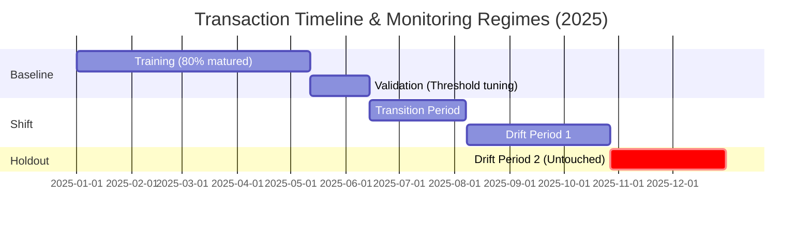

# 🛡️  Financial Fraud Monitoring & Drift Detection System

[](https://www.python.org/)
[](https://scikit-learn.org/)
[](https://xgboost.readthedocs.io/)
[](https://catboost.ai/)
[](https://www.kaggle.com/datasets/neel1237/indian-fraud-transactions-for-monitoring)
[](https://opensource.org/licenses/MIT)

An end-to-end Machine Learning and MLOps system for detecting, monitoring, and adapting to financial fraud in the Indian payments ecosystem (UPI, NetBanking, POS, eCommerce). Built on a realistic 770,000-transaction dataset, this repository implements leakage-safe chronological training, delayed-label feedback simulations, threshold optimization, Population Stability Index (PSI) drift monitoring, and candidate retraining benchmarks.

---

## 📌 Executive Summary

Real-world financial fraud detection differs fundamentally from textbook classification:
1. **Extreme Class Imbalance**: Fraud represents only ~5–7% of normal transactions.
2. **Delayed Ground-Truth Labels**: Fraud outcomes are not known at transaction time; chargeback investigations and disputes require **7 to 28 days to resolve**. Naively training on recent transactions introduces severe target leakage.
3. **Temporal Drift**: Attackers constantly adapt tactics, causing significant **data drift** (shifting transaction distributions) and **concept drift** (shifting relationships between features and fraud).
4. **Asymmetric Business Costs**: Missing fraud causes direct financial loss (False Negatives), while flagging legitimate users causes customer friction and operational review costs (False Positives).

This project addresses each challenge through rigorous pipeline engineering:
- **Primary Model (`main_code.ipynb`)**: XGBoost with median/most-frequent imputation, one-hot encoding, positive-class reweighting (`scale_pos_weight`), and validation-selected Precision-Recall thresholding.
- **Experimental Suite (`experiments/`)**:
  - `other_1.ipynb`: Histogram Gradient Boosting with weekly delayed-label maturation tracking, feature-level Population Stability Index (PSI) monitoring, and retrained Candidate v2.0 benchmark.
  - `other_2.ipynb`: CatBoost with native categorical handling, class-weighted optimization, and a 3-tier operational decision engine (**Approve**, **Manual Review**, **Decline**).

---

## 🏗️ Repository Architecture

```text
financial-fraud-detection-monitoring/
│
├── README.md                           # Master system documentation & benchmarks
├── requirements.txt                    # Project dependencies
├── .gitignore                          # Git rules excluding large raw datasets
├── main_code.ipynb                     # ⭐ Primary Model: XGBoost Pipeline & Holdout Evaluation
│
├── experiments/                        # 🔬 Experimental Models & Advanced MLOps
│   ├── README.md                       # Comparative guide to experimental architectures
│   ├── other_1.ipynb                   # Exp 1: HistGradientBoosting, PSI Drift Monitoring, Delayed Labels
│   ├── other_2.ipynb                   # Exp 2: CatBoost Native Categoricals & 3-Tier Decisioning
│   └── other2.ipynb                    # Compatibility mirror of other_2.ipynb
│
├── data/                               # 📊 Data specifications & sample preview
│   ├── README.md                       # Feature schema & Kaggle download guide
│   └── sample_fraud_transactions.csv   # 1,000-row lightweight preview sample (245 KB)
│
└── scripts/                            # ⚙️ Utility scripts
    └── download_dataset.py             # One-click KaggleHub dataset fetcher
```

---

## 📊 Dataset Specifications

The models are evaluated on a synthetic transactional dataset calibrated against Indian banking patterns:
- **Total Volume**: 770,000 transactions across calendar year 2025.
- **Hosted Publicly**: [Indian Fraud Transactions for Monitoring (Kaggle)](https://www.kaggle.com/datasets/neel1237/indian-fraud-transactions-for-monitoring) (`neel1237/indian-fraud-transactions-for-monitoring`).
- **Payment Channels**: UPI (Unified Payments Interface), POS, eCommerce, Mobile Banking, ATM, IMPS/NEFT/RTGS.
- **Geographic Coverage**: Multi-state distribution across India (Maharashtra, Tamil Nadu, Uttar Pradesh, Gujarat, Delhi, Karnataka, Rajasthan, etc.).
- **Key Engineered Attributes**:
  - `amount_to_avg_ratio`: Deviation of current amount from the customer's 30-day historical average.
  - `failed_auth_24h`: Velocity indicator of failed authentication attempts in the preceding 24 hours.
  - `device_trust_score`: Continuous reputation score of the client hardware/app instance.
  - `distance_from_home_km`: Physical distance between transaction location and customer residence.
  - `label_available_at_ist`: Exact timestamp when the fraud confirmation became available.

### Chronological Regimes:



---

## ⚙️ Primary Model Pipeline (`main_code.ipynb`)

### 1. Leakage-Safe Data Preparation
To strictly prevent target leakage, transactions in the training set whose ground-truth labels were not resolved by the start of the validation window (`2025-05-12`) were removed from training:
```python
training_cutoff = validation_df['event_timestamp_ist'].min()
train_df = train_df.loc[train_df['label_available_at_ist'] <= training_cutoff].copy()
```

### 2. Preprocessing & XGBoost Setup
- **Imputation**: Median imputation for numeric features; Most-Frequent for categorical.
- **Encoding**: One-Hot Encoding for categorical features (`handle_unknown='ignore'`).
- **Class Imbalance Reweighting**:
  $$\text{scale\_pos\_weight} = \frac{N_{\text{legitimate}}}{N_{\text{fraud}}} = 16.51$$
- **Estimator**: `XGBClassifier` with histogram tree method (`tree_method='hist'`), 300 estimators, depth 6, learning rate 0.05.

### 3. Threshold Optimization
Default classification cutoffs ($0.50$) are suboptimal for skewed targets. We sweep the Precision-Recall curve on the held-out validation set to select the threshold that maximizes $F_1$:
- **Selected Cutoff**: $\tau = 0.6892$ (shifts focus towards precision to limit false alarms).

### 4. Primary Model Holdout Results (`drift_period_2`)

| Decision Strategy | Cutoff | Accuracy | Precision | Recall | $F_1$-Score | PR-AUC |
| :--- | :---: | :---: | :---: | :---: | :---: | :---: |
| **Default Threshold** | $0.500$ | 79.72% | 29.11% | 51.75% | 37.26% | 0.322 |
| **Validation-Selected Threshold** | **$0.689$** | **86.21%** | **40.34%** | **38.54%** | **39.42%** | **0.322** |

*All-legitimate baseline accuracy on this holdout is 88.36% (fraud prevalence: 11.64%).*

```text
Confusion Matrix at Selected Threshold (138,600 Transactions):
┌─────────────────────────┬──────────────────────┬─────────────────┐
│                         │ Predicted Legitimate │ Predicted Fraud │
├─────────────────────────┼──────────────────────┼─────────────────┤
│ Actual Legitimate       │       113,273        │      9,196      │
│ Actual Fraud            │         9,914        │      6,217      │
└─────────────────────────┴──────────────────────┴─────────────────┘
```

---

## 🔬 Experimental Suite & Advanced MLOps (`experiments/`)

### Experiment 1: HistGradientBoosting & Drift Monitoring (`experiments/other_1.ipynb`)
- **Population Stability Index (PSI)**: Monitored shift across 4 temporal windows. Identified channels and states experiencing rapid drift during mid-year transitions.
- **Weekly Delayed-Label Performance**: Demonstrated how evaluating unresolved transactions creates artificial spikes in apparent precision.
- **Candidate Retraining (v1.0 vs v2.0)**:
  - Baseline v1.0 PR-AUC: $0.333$ | Brier Score: $0.0954$ | ECE: $0.057$
  - Candidate v2.0 PR-AUC: **$0.339$** | Brier Score: **$0.0922$** | ECE: **$0.040$**
  - Retrained model improved fraud recall from **43.92% to 46.75%** while simultaneously achieving superior probability calibration.

### Experiment 2: CatBoost & 3-Tier Operational Policy (`experiments/other_2.ipynb`)
- **Native Categoricals**: Leveraged CatBoost's target-statistic encoding on multi-class channels and merchant categories, eliminating high-cardinality dimensionality expansion.
- **3-Tier Risk Routing**:
  - **Auto-Decline** ($\ge 0.1059$): Blocks high-probability fraud.
  - **Manual Review** ($0.0636 \le \text{Score} < 0.1059$): Flags suspicious edge cases for human risk analysts.
  - **Auto-Approve** ($< 0.0636$): Seamless frictionless checkout for legitimate customers.
- **Holdout Performance**: Achieved highest overall holdout recall (**49.01%**, catching 7,905 fraud cases).

---

## 🏆 Comprehensive Model Comparison Matrix

Evaluation performed on the final untouched out-of-time holdout (**138,600 transactions, 11.64% fraud prevalence**):

| Model Architecture | Execution Script | Accuracy | Precision | Recall | $F_1$-Score | PR-AUC | Calibration (ECE) | Primary Advantage |
| :--- | :--- | :---: | :---: | :---: | :---: | :---: | :---: | :--- |
| **XGBoost (F1-Tuned)** | [`main_code.ipynb`](main_code.ipynb) | **86.21%** | **40.34%** | 38.54% | 39.42% | 0.322 | — | Lowest False Positive friction (highest precision) |
| **HistGBM Candidate v2.0** | [`experiments/other_1.ipynb`](experiments/other_1.ipynb) | 82.59% | 35.78% | 46.75% | **40.54%** | **0.339** | **0.040** | Best calibrated risk scores; highest PR-AUC |
| **CatBoost Candidate v2.0** | [`experiments/other_2.ipynb`](experiments/other_2.ipynb) | 82.58% | 33.19% | **49.01%** | 39.58% | 0.336 | 0.301 | Maximum fraud capture (highest recall) |

---

## 🚀 Getting Started

### 1. Clone the Repository
```bash
git clone https://github.com/Nee123007/financial-fraud-detection-monitoring.git
cd financial-fraud-detection-monitoring
```

### 2. Set Up Virtual Environment & Dependencies
```bash
# Create and activate environment
python -m venv venv
# Windows:
venv\Scripts\activate
# Linux/macOS:
source venv/bin/activate

# Install dependencies
pip install -r requirements.txt
```

### 3. Fetch the Complete Dataset
Run the automated downloader to retrieve the full 770k transaction dataset from Kaggle:
```bash
python scripts/download_dataset.py
```
*(Alternatively, explore immediately using `data/sample_fraud_transactions.csv`)*

### 4. Launch Jupyter
```bash
jupyter notebook
```
- Open [`main_code.ipynb`](main_code.ipynb) to inspect the primary XGBoost pipeline.
- Open [`experiments/other_1.ipynb`](experiments/other_1.ipynb) for PSI drift monitoring and delayed-label tracking.
- Open [`experiments/other_2.ipynb`](experiments/other_2.ipynb) for CatBoost and 3-tier decisioning.

---

## 💡 Key Lessons for Real-World ML Deployments

1. **Avoid ROC-AUC on Imbalanced Fraud**: ROC-AUC can remain misleadingly high (e.g. >0.90) even when a model generates unacceptable false alarm rates. **PR-AUC and Precision/Recall trade-off curves** provide the true business-relevant picture.
2. **Beware of Recent Data Without Mature Labels**: Transactions in the last 14–30 days cannot be assumed legitimate simply because no dispute was filed yet. Training on immature data trains the model to mistake unconfirmed fraud for legitimate behavior.
3. **Drift Monitoring is Non-Negotiable**: As illustrated in Experiment 1, feature distributions shift significantly over multi-month windows. Continuous PSI monitoring provides early warning signals before production accuracy deteriorates.

---

## 👤 Author

**Neel Parmar**
- GitHub: [@Nee123007](https://github.com/Nee123007)
- Kaggle: [@neel1237](https://www.kaggle.com/neel1237)
- Contact: `yg159120@gmail.com`

---

## 📜 License
This project is licensed under the [MIT License](LICENSE).
